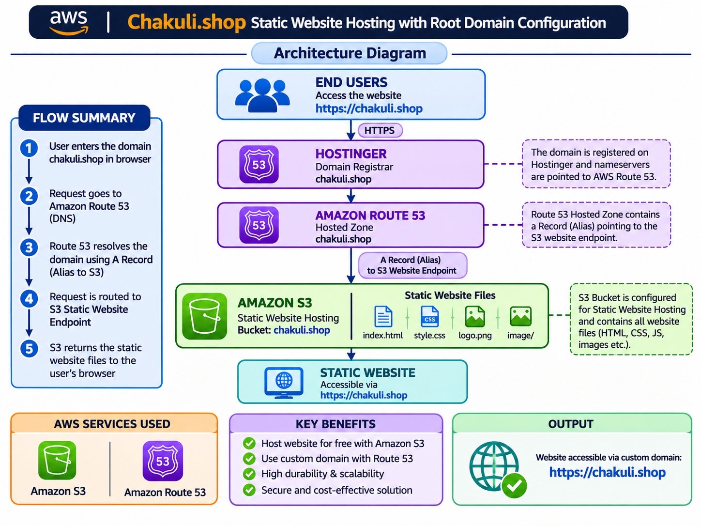

# AWS S3 Static Website Hosting with Root Domain Configuration

**Author:** SAKSHI SOMVANSHI  
**Domain:** `chakuli.shop`  
**Services:** Amazon S3, Amazon Route 53

---

## Overview

This project hosts a static website on **Amazon S3** and maps a **custom root domain** to it using **Amazon Route 53**. Once static website hosting is enabled and the DNS records are configured, the website is publicly accessible through the custom domain.

---

## Architecture

  

## Objectives

- Host a static website without managing any servers
- Use the root domain name as the S3 bucket name
- Map the custom domain to the S3 website endpoint using Route 53
- Make the website publicly accessible through the domain

---

## Architecture Summary

| Component | Role |
|-----------|------|
| Domain Registrar (Hostinger) | Domain is registered here; nameservers point to Route 53 |
| Amazon Route 53 | Hosted Zone with an Alias (A) record to the S3 website endpoint |
| Amazon S3 | Bucket `chakuli.shop` with static website hosting enabled |

**Request flow**

1. The user enters `chakuli.shop` in the browser.
2. DNS lookup is handled by Amazon Route 53.
3. Route 53 resolves the domain using an Alias (A) record to the S3 website endpoint.
4. S3 returns the website files (HTML, CSS, JavaScript, images) to the browser.

---

## Features

- Static website hosted on Amazon S3
- S3 bucket created with the root domain name
- Static website hosting enabled
- Website files uploaded (HTML, CSS, JavaScript, images)
- Public read access configured
- Route 53 Hosted Zone configured
- Alias (A) record created for the S3 website endpoint
- Custom root domain successfully mapped

---

## Implementation Steps

1. Create an S3 bucket named exactly as the domain (`chakuli.shop`).
2. Disable **Block all public access** for the bucket.
3. Enable **Static website hosting** and set `index.html` as the index document.
4. Upload the website files.
5. Add a bucket policy that allows public read access.
6. Create a **Public Hosted Zone** in Route 53 for the domain.
7. Update the nameservers at the domain registrar with the Route 53 NS values.
8. Create an **A record (Alias)** pointing to the S3 website endpoint.
9. Open `http://chakuli.shop` to verify the website.

---

## Outcome

The static website was deployed successfully on Amazon S3 and is accessible through the custom root domain `chakuli.shop` using Amazon Route 53.

---

## Author

**SAKSHI SOMVANSHI**
